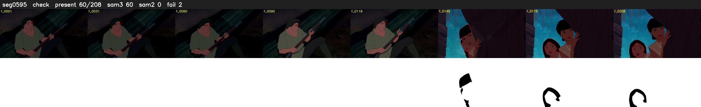

# Segment 595 (shot)

Film frames 50788-50995 (208 frames, 35:18.3-35:27.0).

**Status: check**

| | |
|---|---|
| Frames with her hair | 60 / 208 |
| Mask source | SAM3 60, SAM2 fallback 0 |
| Frames still failing QC | 2 [149, 155] |
| Film indices with no picture (held) | 0 |
| Time | 390 s |

Top: source with the final mask outlined in red. Bottom: white-fill output.

## Issues

- other characters' hair erased on 201 frames
