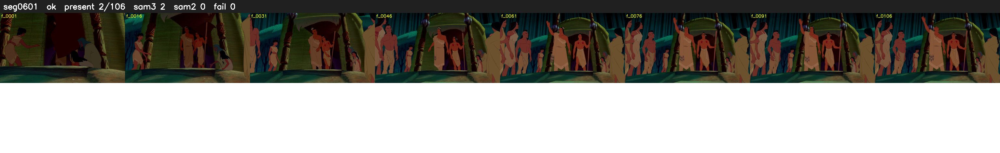

# Segment 601 (shot)

Film frames 51554-51659 (106 frames, 36:50.2-36:54.7).

**Status: ok**

| | |
|---|---|
| Frames with her hair | 2 / 106 |
| Mask source | SAM3 2, SAM2 fallback 0 |
| Frames still failing QC | 0 [] |
| Film indices with no picture (held) | 0 |
| Time | 375 s |

Top: source with the final mask outlined in red. Bottom: white-fill output.

## Issues

- other characters' hair erased on 106 frames
