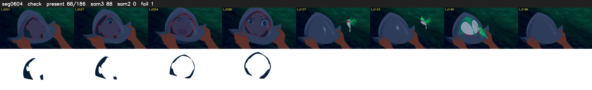

# Segment 604 (shot)

Film frames 51783-51968 (186 frames, 36:59.8-36:07.5).

**Status: check**

| | |
|---|---|
| Frames with her hair | 88 / 186 |
| Mask source | SAM3 88, SAM2 fallback 0 |
| Frames still failing QC | 1 [88] |
| Film indices with no picture (held) | 0 |
| Time | 302 s |

Top: source with the final mask outlined in red. Bottom: white-fill output.

## Issues

- tinted scene: median hair purity 0.00 < 0.5, purity/missed QC off
- fallback 88-88: no seed prompts (cleaned seed too small (0 px): hair lost)
- other characters' hair erased on 60 frames
