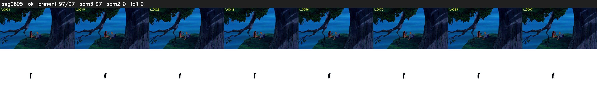

# Segment 605 (shot)

Film frames 51969-52065 (97 frames, 36:07.5-36:11.6).

**Status: ok**

| | |
|---|---|
| Frames with her hair | 97 / 97 |
| Mask source | SAM3 97, SAM2 fallback 0 |
| Frames still failing QC | 0 [] |
| Film indices with no picture (held) | 0 |
| Time | 153 s |

Top: source with the final mask outlined in red. Bottom: white-fill output.
