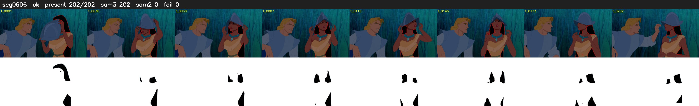

# Segment 606 (shot)

Film frames 52066-52267 (202 frames, 36:11.6-36:20.0).

**Status: ok**

| | |
|---|---|
| Frames with her hair | 202 / 202 |
| Mask source | SAM3 202, SAM2 fallback 0 |
| Frames still failing QC | 0 [] |
| Film indices with no picture (held) | 0 |
| Time | 360 s |

Top: source with the final mask outlined in red. Bottom: white-fill output.
