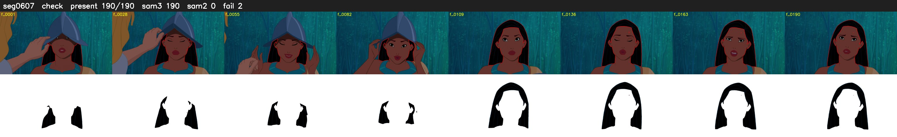

# Segment 607 (shot)

Film frames 52268-52457 (190 frames, 36:20.0-36:27.9).

**Status: check**

| | |
|---|---|
| Frames with her hair | 190 / 190 |
| Mask source | SAM3 190, SAM2 fallback 0 |
| Frames still failing QC | 2 [4, 11] |
| Film indices with no picture (held) | 0 |
| Time | 293 s |

Top: source with the final mask outlined in red. Bottom: white-fill output.
