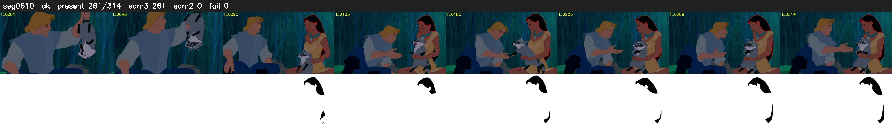

# Segment 610 (shot)

Film frames 52532-52845 (314 frames, 37:31.0-37:44.1).

**Status: ok**

| | |
|---|---|
| Frames with her hair | 261 / 314 |
| Mask source | SAM3 261, SAM2 fallback 0 |
| Frames still failing QC | 0 [] |
| Film indices with no picture (held) | 0 |
| Time | 600 s |

Top: source with the final mask outlined in red. Bottom: white-fill output.

## Issues

- other characters' hair erased on 53 frames
