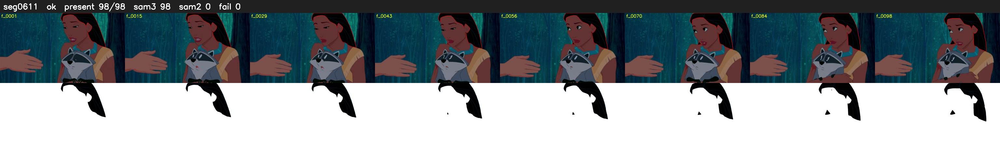

# Segment 611 (shot)

Film frames 52846-52943 (98 frames, 37:44.1-37:48.2).

**Status: ok**

| | |
|---|---|
| Frames with her hair | 98 / 98 |
| Mask source | SAM3 98, SAM2 fallback 0 |
| Frames still failing QC | 0 [] |
| Film indices with no picture (held) | 0 |
| Time | 150 s |

Top: source with the final mask outlined in red. Bottom: white-fill output.
