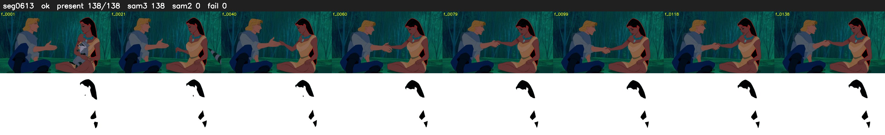

# Segment 613 (shot)

Film frames 53014-53151 (138 frames, 37:51.1-37:56.9).

**Status: ok**

| | |
|---|---|
| Frames with her hair | 138 / 138 |
| Mask source | SAM3 138, SAM2 fallback 0 |
| Frames still failing QC | 0 [] |
| Film indices with no picture (held) | 0 |
| Time | 222 s |

Top: source with the final mask outlined in red. Bottom: white-fill output.
