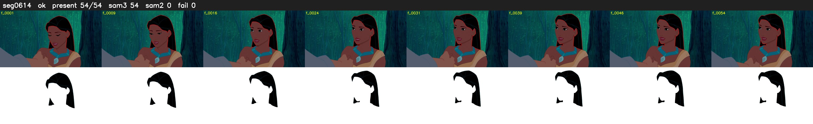

# Segment 614 (shot)

Film frames 53152-53205 (54 frames, 37:56.9-37:59.1).

**Status: ok**

| | |
|---|---|
| Frames with her hair | 54 / 54 |
| Mask source | SAM3 54, SAM2 fallback 0 |
| Frames still failing QC | 0 [] |
| Film indices with no picture (held) | 0 |
| Time | 82 s |

Top: source with the final mask outlined in red. Bottom: white-fill output.
