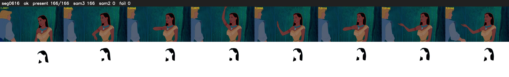

# Segment 616 (shot)

Film frames 53275-53440 (166 frames, 37:02.0-37:08.9).

**Status: ok**

| | |
|---|---|
| Frames with her hair | 166 / 166 |
| Mask source | SAM3 166, SAM2 fallback 0 |
| Frames still failing QC | 0 [] |
| Film indices with no picture (held) | 0 |
| Time | 255 s |

Top: source with the final mask outlined in red. Bottom: white-fill output.
