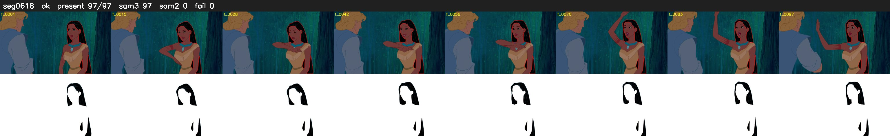

# Segment 618 (shot)

Film frames 53507-53603 (97 frames, 37:11.7-37:15.7).

**Status: ok**

| | |
|---|---|
| Frames with her hair | 97 / 97 |
| Mask source | SAM3 97, SAM2 fallback 0 |
| Frames still failing QC | 0 [] |
| Film indices with no picture (held) | 0 |
| Time | 148 s |

Top: source with the final mask outlined in red. Bottom: white-fill output.
