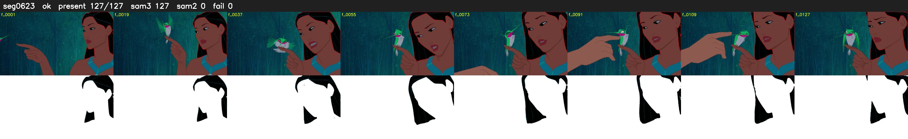

# Segment 623 (shot)

Film frames 53846-53972 (127 frames, 37:25.8-38:31.1).

**Status: ok**

| | |
|---|---|
| Frames with her hair | 127 / 127 |
| Mask source | SAM3 127, SAM2 fallback 0 |
| Frames still failing QC | 0 [] |
| Film indices with no picture (held) | 0 |
| Time | 195 s |

Top: source with the final mask outlined in red. Bottom: white-fill output.
