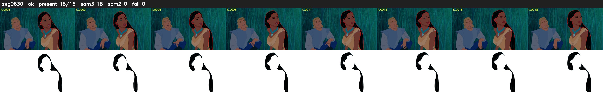

# Segment 630 (shot)

Film frames 54203-54220 (18 frames, 38:40.7-38:41.5).

**Status: ok**

| | |
|---|---|
| Frames with her hair | 18 / 18 |
| Mask source | SAM3 18, SAM2 fallback 0 |
| Frames still failing QC | 0 [] |
| Film indices with no picture (held) | 0 |
| Time | 29 s |

Top: source with the final mask outlined in red. Bottom: white-fill output.
