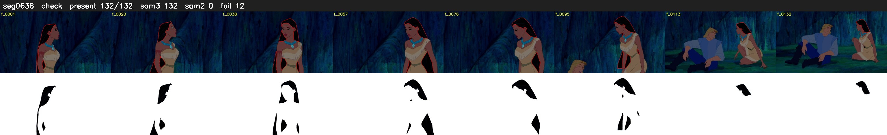

# Segment 638 (shot)

Film frames 54474-54605 (132 frames, 38:52.0-38:57.5).

**Status: check**

| | |
|---|---|
| Frames with her hair | 132 / 132 |
| Mask source | SAM3 132, SAM2 fallback 0 |
| Frames still failing QC | 12 [28, 29, 31, 32, 33, 37, 93, 95, 96, 97, 98, 99] |
| Film indices with no picture (held) | 0 |
| Time | 206 s |

Top: source with the final mask outlined in red. Bottom: white-fill output.
