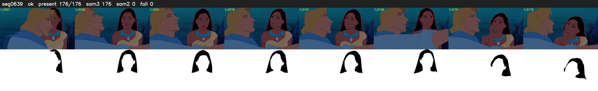

# Segment 639 (shot)

Film frames 54606-54781 (176 frames, 38:57.5-38:04.9).

**Status: ok**

| | |
|---|---|
| Frames with her hair | 176 / 176 |
| Mask source | SAM3 176, SAM2 fallback 0 |
| Frames still failing QC | 0 [] |
| Film indices with no picture (held) | 0 |
| Time | 261 s |

Top: source with the final mask outlined in red. Bottom: white-fill output.
