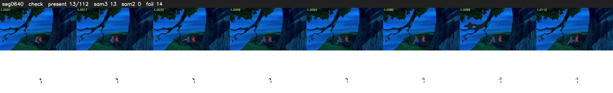

# Segment 640 (shot)

Film frames 54782-54893 (112 frames, 38:04.9-38:09.5).

**Status: check**

| | |
|---|---|
| Frames with her hair | 13 / 112 |
| Mask source | SAM3 13, SAM2 fallback 0 |
| Frames still failing QC | 14 [3, 4, 5, 6, 7, 8, 9, 10, 11, 12, 13, 14, 75, 76] |
| Film indices with no picture (held) | 0 |
| Time | 183 s |

Top: source with the final mask outlined in red. Bottom: white-fill output.

## Issues

- fallback 3-14: no seed prompts (cleaned seed too small (1353 px): hair lost)
- fallback 75-76: no seed prompts (cleaned seed too small (1096 px): hair lost)
- other characters' hair erased on 1 frames
