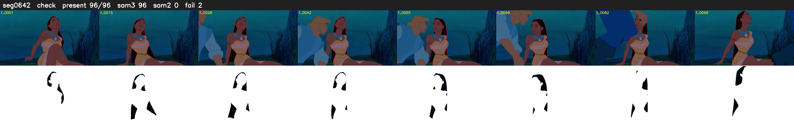

# Segment 642 (shot)

Film frames 54958-55053 (96 frames, 38:12.2-38:16.2).

**Status: check**

| | |
|---|---|
| Frames with her hair | 96 / 96 |
| Mask source | SAM3 96, SAM2 fallback 0 |
| Frames still failing QC | 2 [85, 93] |
| Film indices with no picture (held) | 0 |
| Time | 158 s |

Top: source with the final mask outlined in red. Bottom: white-fill output.
