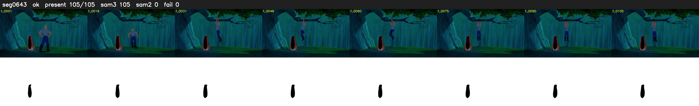

# Segment 643 (shot)

Film frames 55054-55158 (105 frames, 38:16.2-38:20.6).

**Status: ok**

| | |
|---|---|
| Frames with her hair | 105 / 105 |
| Mask source | SAM3 105, SAM2 fallback 0 |
| Frames still failing QC | 0 [] |
| Film indices with no picture (held) | 0 |
| Time | 167 s |

Top: source with the final mask outlined in red. Bottom: white-fill output.
