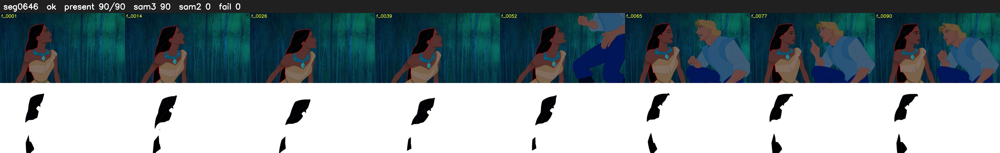

# Segment 646 (shot)

Film frames 55269-55358 (90 frames, 38:25.2-38:28.9).

**Status: ok**

| | |
|---|---|
| Frames with her hair | 90 / 90 |
| Mask source | SAM3 90, SAM2 fallback 0 |
| Frames still failing QC | 0 [] |
| Film indices with no picture (held) | 0 |
| Time | 140 s |

Top: source with the final mask outlined in red. Bottom: white-fill output.
