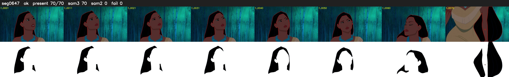

# Segment 647 (shot)

Film frames 55359-55428 (70 frames, 38:28.9-39:31.9).

**Status: ok**

| | |
|---|---|
| Frames with her hair | 70 / 70 |
| Mask source | SAM3 70, SAM2 fallback 0 |
| Frames still failing QC | 0 [] |
| Film indices with no picture (held) | 0 |
| Time | 109 s |

Top: source with the final mask outlined in red. Bottom: white-fill output.
