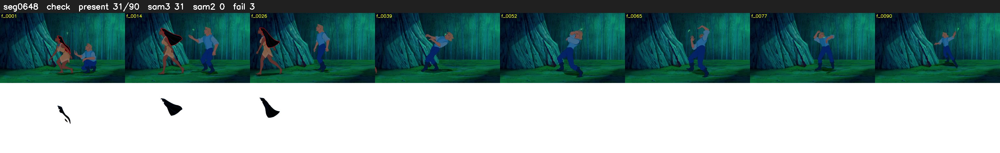

# Segment 648 (shot)

Film frames 55429-55518 (90 frames, 39:31.9-39:35.6).

**Status: check**

| | |
|---|---|
| Frames with her hair | 31 / 90 |
| Mask source | SAM3 31, SAM2 fallback 0 |
| Frames still failing QC | 3 [1, 2, 31] |
| Film indices with no picture (held) | 0 |
| Time | 144 s |

Top: source with the final mask outlined in red. Bottom: white-fill output.

## Issues

- other characters' hair erased on 50 frames
