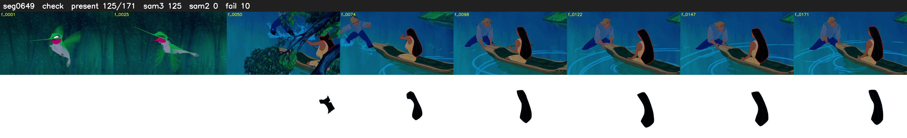

# Segment 649 (shot)

Film frames 55519-55689 (171 frames, 39:35.6-39:42.7).

**Status: check**

| | |
|---|---|
| Frames with her hair | 125 / 171 |
| Mask source | SAM3 125, SAM2 fallback 0 |
| Frames still failing QC | 10 [43, 44, 45, 46, 47, 48, 49, 50, 51, 52] |
| Film indices with no picture (held) | 0 |
| Time | 269 s |

Top: source with the final mask outlined in red. Bottom: white-fill output.

## Issues

- fallback 43-52: no seed prompts (cleaned seed too small (3206 px): hair lost)
- other characters' hair erased on 36 frames
