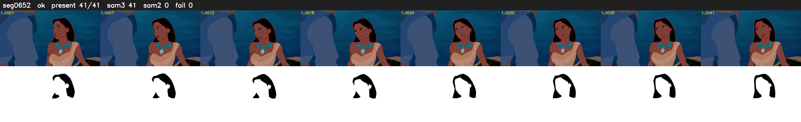

# Segment 652 (shot)

Film frames 55774-55814 (41 frames, 39:46.2-39:48.0).

**Status: ok**

| | |
|---|---|
| Frames with her hair | 41 / 41 |
| Mask source | SAM3 41, SAM2 fallback 0 |
| Frames still failing QC | 0 [] |
| Film indices with no picture (held) | 0 |
| Time | 69 s |

Top: source with the final mask outlined in red. Bottom: white-fill output.

## Issues

- other characters' hair erased on 14 frames
