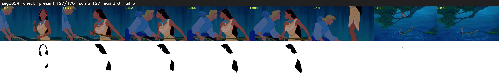

# Segment 654 (shot)

Film frames 55873-56048 (176 frames, 39:50.4-39:57.7).

**Status: check**

| | |
|---|---|
| Frames with her hair | 127 / 176 |
| Mask source | SAM3 127, SAM2 fallback 0 |
| Frames still failing QC | 3 [126, 127, 128] |
| Film indices with no picture (held) | 0 |
| Time | 271 s |

Top: source with the final mask outlined in red. Bottom: white-fill output.

## Issues

- other characters' hair erased on 12 frames
