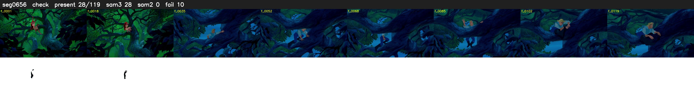

# Segment 656 (shot)

Film frames 56108-56226 (119 frames, 39:00.2-39:05.1).

**Status: check**

| | |
|---|---|
| Frames with her hair | 28 / 119 |
| Mask source | SAM3 28, SAM2 fallback 0 |
| Frames still failing QC | 10 [3, 17, 21, 22, 23, 24, 25, 26, 27, 28] |
| Film indices with no picture (held) | 0 |
| Time | 202 s |

Top: source with the final mask outlined in red. Bottom: white-fill output.

## SAM2 fallbacks

| Frames | Anchor | Direction | SAM2 used |
|---|---|---|---|
| 17-17 | 16 | forward | 0/1 |

## Issues

- fallback 3-3: no seed prompts (cleaned seed too small (2935 px): hair lost)
- fallback 21-28: no seed prompts (cleaned seed too small (4271 px): hair lost)
- other characters' hair erased on 79 frames
