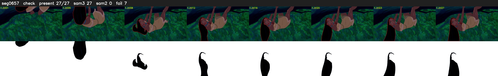

# Segment 657 (shot)

Film frames 56227-56253 (27 frames, 39:05.1-39:06.3).

**Status: check**

| | |
|---|---|
| Frames with her hair | 27 / 27 |
| Mask source | SAM3 27, SAM2 fallback 0 |
| Frames still failing QC | 7 [1, 2, 3, 4, 5, 6, 7] |
| Film indices with no picture (held) | 0 |
| Time | 43 s |

Top: source with the final mask outlined in red. Bottom: white-fill output.
