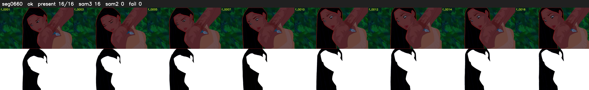

# Segment 660 (shot)

Film frames 56393-56408 (16 frames, 39:12.1-39:12.7).

**Status: ok**

| | |
|---|---|
| Frames with her hair | 16 / 16 |
| Mask source | SAM3 16, SAM2 fallback 0 |
| Frames still failing QC | 0 [] |
| Film indices with no picture (held) | 0 |
| Time | 24 s |

Top: source with the final mask outlined in red. Bottom: white-fill output.
