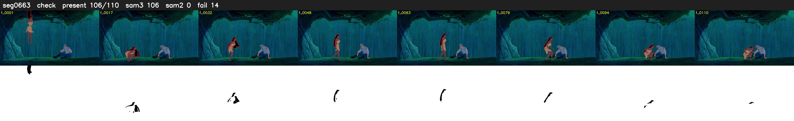

# Segment 663 (shot)

Film frames 56470-56579 (110 frames, 39:15.3-39:19.9).

**Status: check**

| | |
|---|---|
| Frames with her hair | 106 / 110 |
| Mask source | SAM3 106, SAM2 fallback 0 |
| Frames still failing QC | 14 [1, 2, 9, 10, 11, 39, 99, 100, 101, 102, 103, 104, 105, 106] |
| Film indices with no picture (held) | 0 |
| Time | 175 s |

Top: source with the final mask outlined in red. Bottom: white-fill output.
