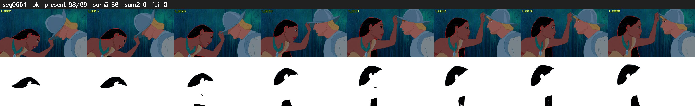

# Segment 664 (shot)

Film frames 56580-56667 (88 frames, 39:19.9-39:23.5).

**Status: ok**

| | |
|---|---|
| Frames with her hair | 88 / 88 |
| Mask source | SAM3 88, SAM2 fallback 0 |
| Frames still failing QC | 0 [] |
| Film indices with no picture (held) | 0 |
| Time | 165 s |

Top: source with the final mask outlined in red. Bottom: white-fill output.
