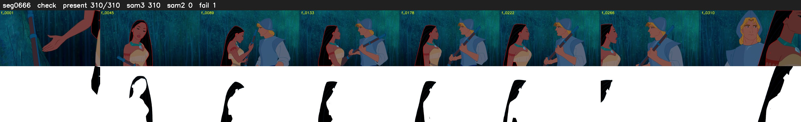

# Segment 666 (shot)

Film frames 56843-57152 (310 frames, 40:30.8-40:43.8).

**Status: check**

| | |
|---|---|
| Frames with her hair | 310 / 310 |
| Mask source | SAM3 310, SAM2 fallback 0 |
| Frames still failing QC | 1 [13] |
| Film indices with no picture (held) | 0 |
| Time | 472 s |

Top: source with the final mask outlined in red. Bottom: white-fill output.
