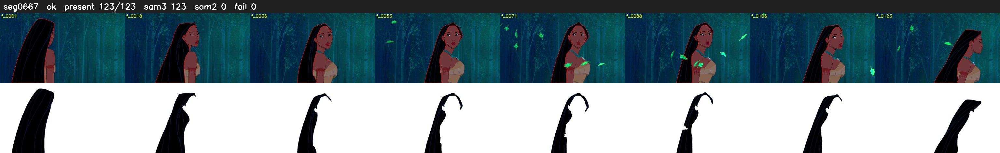

# Segment 667 (shot)

Film frames 57153-57275 (123 frames, 40:43.8-40:48.9).

**Status: ok**

| | |
|---|---|
| Frames with her hair | 123 / 123 |
| Mask source | SAM3 123, SAM2 fallback 0 |
| Frames still failing QC | 0 [] |
| Film indices with no picture (held) | 0 |
| Time | 187 s |

Top: source with the final mask outlined in red. Bottom: white-fill output.
