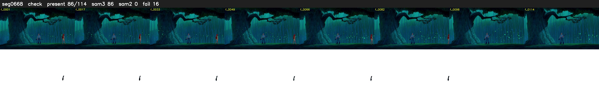

# Segment 668 (shot)

Film frames 57276-57389 (114 frames, 40:48.9-40:53.6).

**Status: check**

| | |
|---|---|
| Frames with her hair | 86 / 114 |
| Mask source | SAM3 86, SAM2 fallback 0 |
| Frames still failing QC | 16 [33, 37, 41, 47, 48, 49, 50, 51, 52, 55, 56, 60, 73, 74, 75, 76] |
| Film indices with no picture (held) | 0 |
| Time | 180 s |

Top: source with the final mask outlined in red. Bottom: white-fill output.

## Issues

- fallback 33-33: no seed prompts (cleaned seed too small (1880 px): hair lost)
- fallback 37-37: no seed prompts (cleaned seed too small (1901 px): hair lost)
- fallback 41-41: no seed prompts (cleaned seed too small (1676 px): hair lost)
- fallback 47-52: no seed prompts (cleaned seed too small (1671 px): hair lost)
- fallback 55-56: no seed prompts (cleaned seed too small (1555 px): hair lost)
- fallback 60-60: no seed prompts (cleaned seed too small (1759 px): hair lost)
- fallback 73-76: no seed prompts (cleaned seed too small (1887 px): hair lost)
