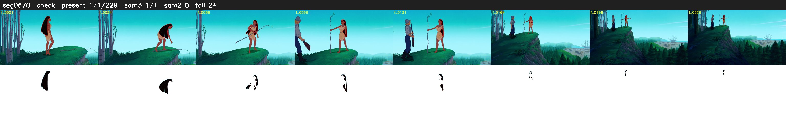

# Segment 670 (shot)

Film frames 57466-57694 (229 frames, 40:56.8-40:06.4).

**Status: check**

| | |
|---|---|
| Frames with her hair | 171 / 229 |
| Mask source | SAM3 171, SAM2 fallback 0 |
| Frames still failing QC | 24 [89, 90, 96, 148, 152, 153, 154, 155, 156, 157, 158, 159, 160, 161, 162, 163, 164, 165, 166, 167] |
| Film indices with no picture (held) | 0 |
| Time | 361 s |

Top: source with the final mask outlined in red. Bottom: white-fill output.
