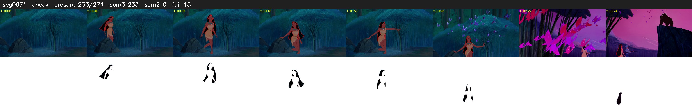

# Segment 671 (shot)

Film frames 57695-57968 (274 frames, 40:06.4-40:17.8).

**Status: check**

| | |
|---|---|
| Frames with her hair | 233 / 274 |
| Mask source | SAM3 233, SAM2 fallback 0 |
| Frames still failing QC | 15 [201, 230, 231, 232, 233, 234, 235, 236, 237, 241, 242, 243, 244, 245, 246] |
| Film indices with no picture (held) | 0 |
| Time | 440 s |

Top: source with the final mask outlined in red. Bottom: white-fill output.

## Issues

- other characters' hair erased on 16 frames
