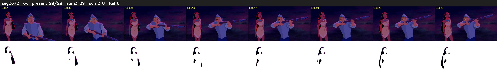

# Segment 672 (shot)

Film frames 57969-57997 (29 frames, 40:17.8-40:19.0).

**Status: ok**

| | |
|---|---|
| Frames with her hair | 29 / 29 |
| Mask source | SAM3 29, SAM2 fallback 0 |
| Frames still failing QC | 0 [] |
| Film indices with no picture (held) | 0 |
| Time | 44 s |

Top: source with the final mask outlined in red. Bottom: white-fill output.

## Issues

- dusk scene: median hair purity 0.69 < 0.75, purity QC off
