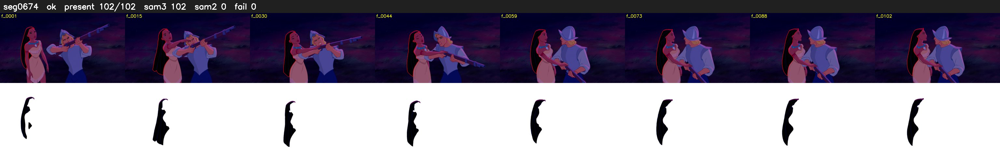

# Segment 674 (shot)

Film frames 58025-58126 (102 frames, 40:20.1-40:24.4).

**Status: ok**

| | |
|---|---|
| Frames with her hair | 102 / 102 |
| Mask source | SAM3 102, SAM2 fallback 0 |
| Frames still failing QC | 0 [] |
| Film indices with no picture (held) | 0 |
| Time | 153 s |

Top: source with the final mask outlined in red. Bottom: white-fill output.
