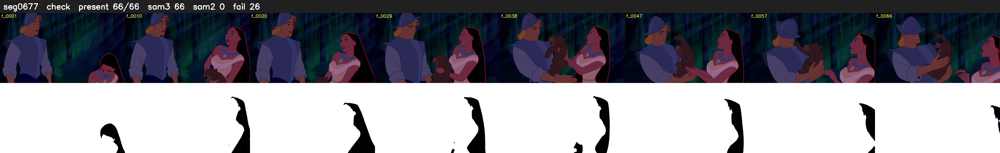

# Segment 677 (shot)

Film frames 58279-58344 (66 frames, 41:30.7-41:33.5).

**Status: check**

| | |
|---|---|
| Frames with her hair | 66 / 66 |
| Mask source | SAM3 66, SAM2 fallback 0 |
| Frames still failing QC | 26 [1, 4, 5, 26, 27, 28, 29, 30, 31, 32, 33, 34, 35, 36, 37, 38, 39, 40, 41, 42] |
| Film indices with no picture (held) | 0 |
| Time | 103 s |

Top: source with the final mask outlined in red. Bottom: white-fill output.
