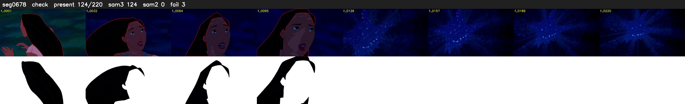

# Segment 678 (shot)

Film frames 58345-58564 (220 frames, 41:33.5-41:42.6).

**Status: check**

| | |
|---|---|
| Frames with her hair | 124 / 220 |
| Mask source | SAM3 124, SAM2 fallback 0 |
| Frames still failing QC | 3 [121, 123, 124] |
| Film indices with no picture (held) | 0 |
| Time | 324 s |

Top: source with the final mask outlined in red. Bottom: white-fill output.

## Issues

- other characters' hair erased on 81 frames
