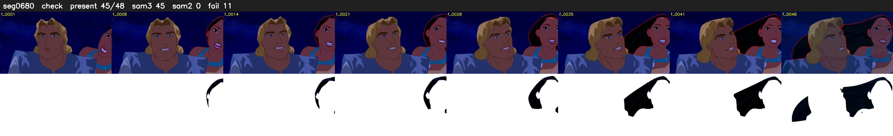

# Segment 680 (shot)

Film frames 58593-58640 (48 frames, 41:43.8-41:45.8).

**Status: check**

| | |
|---|---|
| Frames with her hair | 45 / 48 |
| Mask source | SAM3 45, SAM2 fallback 0 |
| Frames still failing QC | 11 [4, 5, 6, 7, 8, 9, 10, 11, 12, 13, 15] |
| Film indices with no picture (held) | 0 |
| Time | 86 s |

Top: source with the final mask outlined in red. Bottom: white-fill output.

## SAM2 fallbacks

| Frames | Anchor | Direction | SAM2 used |
|---|---|---|---|
| 4-13 | 14 | backward | 0/10 |
| 15-15 | 14 | forward | 0/1 |

## Issues

- other characters' hair erased on 3 frames
