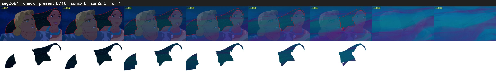

# Segment 681 (transition)

Film frames 58641-58650 (10 frames, 41:45.8-41:46.2).

**Status: check**

| | |
|---|---|
| Frames with her hair | 8 / 10 |
| Mask source | SAM3 8, SAM2 fallback 0 |
| Frames still failing QC | 1 [8] |
| Film indices with no picture (held) | 0 |
| Time | 20 s |

Top: source with the final mask outlined in red. Bottom: white-fill output.

## Issues

- tinted scene: median hair purity 0.00 < 0.5, purity/missed QC off
- fallback 8-8: no seed prompts (cleaned seed too small (0 px): hair lost)
