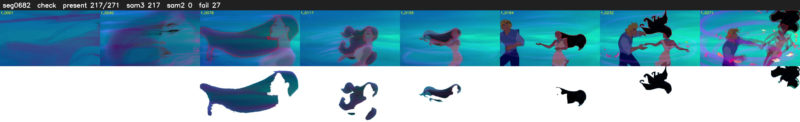

# Segment 682 (shot)

Film frames 58651-58921 (271 frames, 41:46.2-41:57.5).

**Status: check**

| | |
|---|---|
| Frames with her hair | 217 / 271 |
| Mask source | SAM3 217, SAM2 fallback 0 |
| Frames still failing QC | 27 [39, 40, 41, 42, 43, 44, 45, 46, 54, 55, 57, 63, 66, 67, 88, 89, 90, 91, 92, 94] |
| Film indices with no picture (held) | 0 |
| Time | 456 s |

Top: source with the final mask outlined in red. Bottom: white-fill output.

## Issues

- tinted scene: median hair purity 0.21 < 0.5, purity/missed QC off
- fallback 39-46: no seed prompts (cleaned seed too small (2472 px): hair lost)
- fallback 54-55: no seed prompts (cleaned seed too small (0 px): hair lost)
- fallback 57-57: no seed prompts (cleaned seed too small (0 px): hair lost)
- fallback 63-63: no seed prompts (cleaned seed too small (0 px): hair lost)
- fallback 66-67: no seed prompts (cleaned seed too small (0 px): hair lost)
- fallback 88-92: no seed prompts (cleaned seed too small (0 px): hair lost)
- fallback 94-100: no seed prompts (cleaned seed too small (0 px): hair lost)
- fallback 103-103: no seed prompts (cleaned seed too small (0 px): hair lost)
- other characters' hair erased on 44 frames
