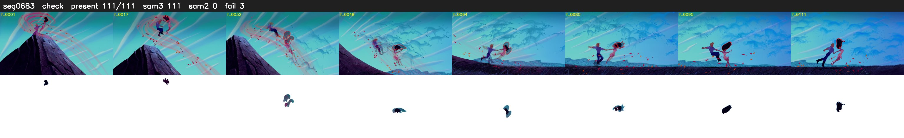

# Segment 683 (shot)

Film frames 58922-59032 (111 frames, 41:57.5-41:02.2).

**Status: check**

| | |
|---|---|
| Frames with her hair | 111 / 111 |
| Mask source | SAM3 111, SAM2 fallback 0 |
| Frames still failing QC | 3 [4, 42, 44] |
| Film indices with no picture (held) | 0 |
| Time | 174 s |

Top: source with the final mask outlined in red. Bottom: white-fill output.

## Issues

- dusk scene: median hair purity 0.55 < 0.75, purity QC off
