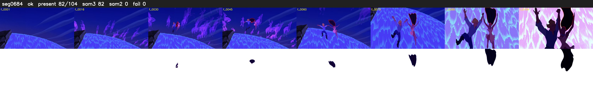

# Segment 684 (shot)

Film frames 59033-59136 (104 frames, 41:02.2-41:06.5).

**Status: ok**

| | |
|---|---|
| Frames with her hair | 82 / 104 |
| Mask source | SAM3 82, SAM2 fallback 0 |
| Frames still failing QC | 0 [] |
| Film indices with no picture (held) | 0 |
| Time | 155 s |

Top: source with the final mask outlined in red. Bottom: white-fill output.

## Issues

- tinted scene: median hair purity 0.00 < 0.5, purity/missed QC off
- other characters' hair erased on 5 frames
