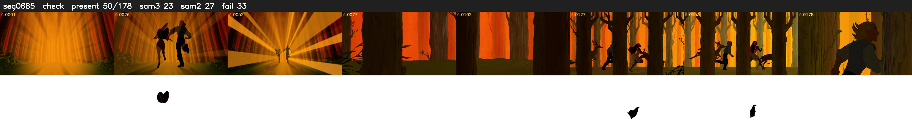

# Segment 685 (shot)

Film frames 59137-59314 (178 frames, 41:06.5-41:13.9).

**Status: check**

| | |
|---|---|
| Frames with her hair | 50 / 178 |
| Mask source | SAM3 23, SAM2 fallback 27 |
| Frames still failing QC | 33 [21, 30, 31, 32, 111, 112, 114, 115, 116, 117, 118, 119, 120, 121, 123, 125, 126, 127, 128, 129] |
| Film indices with no picture (held) | 0 |
| Time | 353 s |

Top: source with the final mask outlined in red. Bottom: white-fill output.

## SAM2 fallbacks

| Frames | Anchor | Direction | SAM2 used |
|---|---|---|---|
| 23-32 | 22 | forward | 8/10 |
| 111-112 | 113 | backward | 0/2 |
| 114-119 | 113 | forward | 3/6 |
| 123-123 | 122 | forward | 0/1 |
| 125-130 | 124 | forward | 4/6 |
| 134-141 | 133 | forward | 7/8 |
| 146-147 | 145 | forward | 2/2 |
| 149-152 | 148 | forward | 3/4 |

## Issues

- manual override: step 18 gaps: sunset run, SAM3 misses her silhouette hair f23-30
- fallback 121-121: no seed prompts (cleaned seed too small (4456 px): hair lost)
- other characters' hair erased on 114 frames
