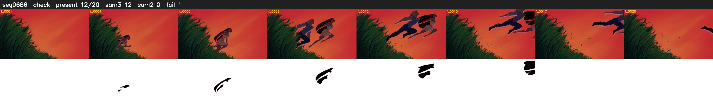

# Segment 686 (shot)

Film frames 59315-59334 (20 frames, 41:13.9-41:14.8).

**Status: check**

| | |
|---|---|
| Frames with her hair | 12 / 20 |
| Mask source | SAM3 12, SAM2 fallback 0 |
| Frames still failing QC | 1 [15] |
| Film indices with no picture (held) | 0 |
| Time | 33 s |

Top: source with the final mask outlined in red. Bottom: white-fill output.

## Issues

- other characters' hair erased on 8 frames
