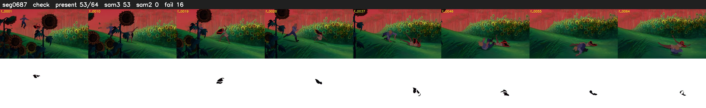

# Segment 687 (shot)

Film frames 59335-59398 (64 frames, 41:14.8-41:17.4).

**Status: check**

| | |
|---|---|
| Frames with her hair | 53 / 64 |
| Mask source | SAM3 53, SAM2 fallback 0 |
| Frames still failing QC | 16 [2, 3, 4, 5, 6, 7, 8, 9, 10, 11, 12, 13, 14, 15, 50, 60] |
| Film indices with no picture (held) | 0 |
| Time | 104 s |

Top: source with the final mask outlined in red. Bottom: white-fill output.

## Issues

- fallback 2-15: no seed prompts (cleaned seed too small (4441 px): hair lost)
- fallback 50-50: no seed prompts (cleaned seed too small (3968 px): hair lost)
- fallback 60-60: no seed prompts (cleaned seed too small (1936 px): hair lost)
- other characters' hair erased on 12 frames
