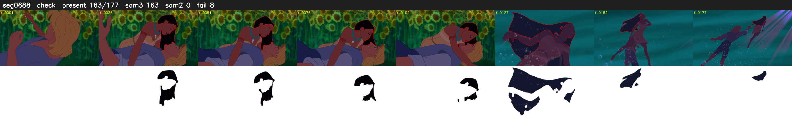

# Segment 688 (shot)

Film frames 59399-59575 (177 frames, 41:17.4-41:24.8).

**Status: check**

| | |
|---|---|
| Frames with her hair | 163 / 177 |
| Mask source | SAM3 163, SAM2 fallback 0 |
| Frames still failing QC | 8 [2, 103, 117, 119, 120, 121, 122, 126] |
| Film indices with no picture (held) | 0 |
| Time | 272 s |

Top: source with the final mask outlined in red. Bottom: white-fill output.

## Issues

- other characters' hair erased on 13 frames
