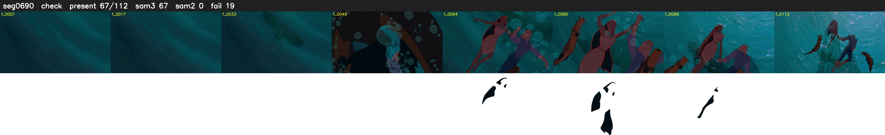

# Segment 690 (shot)

Film frames 59640-59751 (112 frames, 41:27.5-42:32.2).

**Status: check**

| | |
|---|---|
| Frames with her hair | 67 / 112 |
| Mask source | SAM3 67, SAM2 fallback 0 |
| Frames still failing QC | 19 [43, 44, 46, 47, 48, 49, 50, 51, 53, 54, 77, 102, 103, 104, 105, 106, 108, 109, 110] |
| Film indices with no picture (held) | 0 |
| Time | 192 s |

Top: source with the final mask outlined in red. Bottom: white-fill output.

## Issues

- other characters' hair erased on 50 frames
