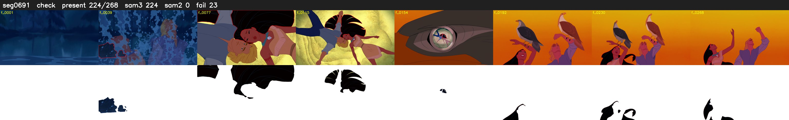

# Segment 691 (shot)

Film frames 59752-60019 (268 frames, 42:32.2-42:43.3).

**Status: check**

| | |
|---|---|
| Frames with her hair | 224 / 268 |
| Mask source | SAM3 224, SAM2 fallback 0 |
| Frames still failing QC | 23 [4, 5, 12, 13, 14, 15, 16, 17, 18, 19, 20, 21, 22, 23, 24, 25, 26, 27, 35, 49] |
| Film indices with no picture (held) | 0 |
| Time | 477 s |

Top: source with the final mask outlined in red. Bottom: white-fill output.

## Issues

- other characters' hair erased on 46 frames
